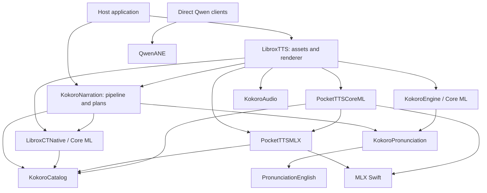

# LibroxTTS architecture — 0.9 candidate

Reviewed on 2026-11-11 against `f75bacfbdc86c0c6dd81f0fb11cb9bcd160e49dd` (0.6.2).
The [architecture review](docs/architecture-review-2026-11-11.md) records the
baseline and roadmap. [Implementation evidence](docs/implementation-07.md)
distinguishes completed changes from remaining qualification.
The [0.8 implementation record](docs/implementation-08.md) extends that baseline.
The [0.9 implementation record](docs/implementation-09.md) records preparation,
planning and verified-publication changes and the gated cache experiment.

## Public entry points and ownership

- `NarrationAssets`: manifest selection, downloads, verification, compilation,
  reuse and per-language removal. The host supplies storage and serializes
  installation against generation; staged installations are adopted by the host.
- `NarrationPipeline`: actor owning book planning, language/voice resolution,
  optional casts, dictionary readings, source ranges and expression preparation.
- `NarrationRenderer`: actor and explicit FIFO lease spanning calls into engine
  actors. Owns selection, installation identity, execution policy and model lifetime.
- Direct engine products remain independently public. Applications can bypass
  the facade; their contracts also need compatibility coverage.
- The host owns playback, audio-session/OS lifecycle, audible position and the
  prepared-audio cache. Synthesis completion is not playback completion.

This is the significant dependency graph, not every manifest edge. The full
31-target graph and 20 products are recorded in
[`inventory.json`](docs/architecture-07/inventory.json). `LibroxTTS` is implemented
under `Sources/KokoroKit`; its public name must remain `LibroxTTS`.

## Execution and state

Text normalization shares only immutable compiled regular expressions behind a
bounded, synchronized cache. Matching and replacement run outside the lock;
recursive numeric readings remain safe. Mutable formatters remain invocation-local.
Digit-free text skips numeric productions, retaining Italian's lexical hour
correction. Rule order, prefix-scan decisions and cache identities remain unchanged.

Long eligible source units can use `PlainNarrationBudget`: per-sentence NFC/NFKD
scalar prefix sums keyed by original UTF-16 grapheme boundaries. The normalizer
owns the conservative eligibility rules, including safe quote combinations and
Italian. Contextual rewrites, possible custom-reading matches and unsupported
scripts abstain; unrelated dictionary entries and neighboring contextual sentences
do not disqualify a safe sentence. Construction is deferred until a source unit
exceeds its budget. The planner still selects the first failing prefix in the
same order, then performs full normalization for the final synthesis text.

English `Lexicon` instances share immutable decoded dictionaries by dialect through
a synchronized weak resource cache. Live clients own the dictionaries; releasing
the last client releases the resources. Mutable frontend/tagger and DSP state
remains caller-owned. DSP and verified prompt reuse were measured but not adopted.

| Path | Execution | Stateful resources | Output |
|---|---|---|---|
| Basic | `KokoroEngine` actor; synchronous Core ML calls | One current voice pack, frontend, bounded decoder | Complete 24 kHz mono Float32 PCM |
| Plus | `CTEngine` actor; synchronous Core ML calls | Text graphs, active generator specialization, vocoder, voice features | Complete 44.1 kHz mono Float32 PCM |
| Max iPhone/iPad | `PocketTTSCoreMLEngine` actor, Core ML CPU | Language models, three flow graphs keyed by graph identity, RNG, invocation caches | 24 kHz PCM; synchronous throwing 1,920-sample frame callback |
| Max Mac/Catalyst | `PocketTTSEngine` actor, MLX; execution-context selection | One language model, per-engine RNG, streaming Mimi and attention state | 24 kHz PCM; synchronous throwing frame callback |
| Qwen | Synchronous `NSLock`-serialized engine; optional serial vocoder queue | Prompt caches, ANE talker state, bounded voice priming cache | Complete PCM and optional asynchronous-queue chunk delivery |
| Pronunciation/DSP | Synchronous, caller-owned mutable instances | Language resources/taggers or FFT/history buffers | Phonemes/diagnostics or processed PCM |

The renderer lease matters because actors are reentrant at `await`. Removing it
without a replacement could allow unload or voice selection to interleave with
an active render. Max callbacks execute on the engine actor, provide backpressure,
and may throw. They must not be converted into unbounded fire-and-forget work.

`NarrationAdmission` owns a synchronized FIFO lease. Throwing load/render work
can cancel while queued; settings, unload and uninstall join their predecessors.
Queue cancellation never releases active ownership. `NarrationSession` pairs one
loaded identity with exactly one engine. Max dispatch has an internal production
adapter and a controlled test actor; the public engine products are unchanged.

Core ML asset preparation recovers verified canonical, previous or completed
staging generations before compiling. Host serialization remains required.
`PreparedModelTransaction` owns recoverable publication and cleanup; receipts
retain source/OS identity checks and full byte hashes. Plus compiler locks are
exclusive per cache key, with a shared legacy lock excluding older SDK writers.

`VerifiedAssetTransfer` centralizes per-file download, verification, cleanup and
progress. Basic/narration callers retain their public size/error policies.
`VerifiedFilePublication` stages and verifies a sibling copy before replacing
installed bytes. Injectable copy/adopt/download operations allow filesystem and
network failure tests without live downloads. This is a per-file publication
boundary, not a multi-file transaction or concurrent-installation coordinator.

The Max MLX engine's private request boundary owns common validation and model
preparation. Complete and streamed bodies keep their distinct budget/callback
ordering. Backend execution still owns RNG and retirement; no public engine type
has moved and no universal engine protocol has been introduced.

Each loaded Core ML language owns `PocketFlowModels`. Placement and source root
are fixed for that owner, so the graph name uniquely identifies each resident
model. Generic sampler counts share `flowstep`; 4 and 8 retain their specialized
graphs. Failed loads do not enter the cache. Retiring the language retires all
three models; preview warming and per-render voice-state loading are unchanged.

The Core ML transformer-to-flow bridge validates Float32 and element count,
then uses compatible arrays directly or a read-only shape view that retains its
source array. Strided outputs retain the logical-order copying fallback. The
view lives only through synchronous flow prediction inside the existing
autorelease pool; mutable attention/Mimi state and emitted PCM are never pooled.
Plus constructs its waveform diagnostic tensor only when tracing is enabled;
ordinary synthesis returns the same validated PCM without the extra Data copy.

## Contracts beyond Swift signatures

- The source plan retains original UTF-16 ranges; synthesis text may differ.
- Max chunk metadata describes completed prepared-text chunks in cumulative
  source samples, not word alignment. Events follow acceptance of their frames.
- Default voice/style/sampling, platform routing and legacy Codable cases are
  explicit compatibility requirements. Model and audio-cache identities differ.
- A partial/cancelled stream is not a complete prepared audio artifact.
- Backend/voice changes preserve model semantics; there is no implicit quality
  reduction or alternate-voice retry.
- Asset hashes are checked before trust. Fast file-presence checks are not
  substitutes for validation. Compilation receipts depend on source and OS.

## Current validation boundary

Full 0.9 Debug and Release suites pass. English/Spanish Core ML Plus/Max fixtures
match 0.6.2 PCM and completed chunk events exactly across 32 recordings and
2,047,104 samples. Generic iOS and Catalyst Release builds pass. The macOS public
inventory remains 2,802 declarations with zero changes; it is not binary-ABI
certification. Real renderer parity also passes for cold/warm MLX CPU/GPU,
streaming and Core ML cancellation/recovery.

The new eight-case sidecar passes exact PCM/events in ABBA runs on Core ML,
MLX CPU and MLX GPU. Dictionary ownership and broader long-sentence planning
have measured gains; general inference throughput is essentially unchanged.
DSP/prompt reuse did not justify adoption. An actual-model capacity prototype
passes the sixteen CPU/GPU audio cases but fails the public mutable-reference
contract, so production retains concatenation. See the 0.9 implementation report
for raw measurements, failed experiment evidence and reproduction.

Physical devices, minimum Swift 6.3, longer thermal/energy sessions, broader
language/listening coverage and Basic/Qwen real-model qualification remain open.
The package suites do not turn generic client compilation into device-runtime
acceptance. No models, sampler defaults, platform routing or audio identities
changed; no release, tag or integration is implied by these local gates.
