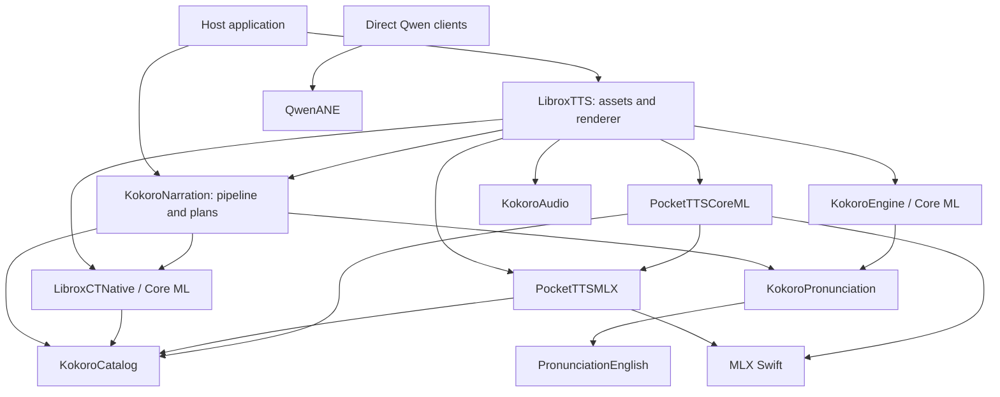

# LibroxTTS architecture — 0.6.2 baseline for 0.7

Reviewed on 2026-11-11 at `f75bacfbdc86c0c6dd81f0fb11cb9bcd160e49dd`.
This describes the existing implementation. Proposed changes are in
[the 0.7 architecture review](docs/architecture-review-2026-11-11.md).

## Public entry points and ownership

- `NarrationAssets`: manifest selection, downloads, verification, compilation,
  reuse and per-language removal. The host supplies storage and serializes
  installation against generation; staged installations are adopted by the host.
- `NarrationPipeline`: actor owning book planning, language/voice resolution,
  optional casts, dictionary readings, source ranges and expression preparation.
- `NarrationRenderer`: actor and explicit FIFO lease spanning calls into engine
  actors. Owns selection, installation identity, execution policy and model lifetime.
- Direct engine products remain independently public. Applications can bypass
  the facade; their contracts also need compatibility coverage.
- The host owns playback, audio-session/OS lifecycle, audible position and the
  prepared-audio cache. Synthesis completion is not playback completion.

This is the significant dependency graph, not every manifest edge. The full
31-target graph and 20 products are recorded in
[`inventory.json`](docs/architecture-07/inventory.json). `LibroxTTS` is implemented
under `Sources/KokoroKit`; its public name must remain `LibroxTTS`.

## Execution and state

| Path | Execution | Stateful resources | Output |
|---|---|---|---|
| Basic | `KokoroEngine` actor; synchronous Core ML calls | One current voice pack, frontend, bounded decoder | Complete 24 kHz mono Float32 PCM |
| Plus | `CTEngine` actor; synchronous Core ML calls | Text graphs, active generator specialization, vocoder, voice features | Complete 44.1 kHz mono Float32 PCM |
| Max iPhone/iPad | `PocketTTSCoreMLEngine` actor, Core ML CPU | Language models, per-step flow dictionary, RNG, invocation caches | 24 kHz PCM; synchronous throwing 1,920-sample frame callback |
| Max Mac/Catalyst | `PocketTTSEngine` actor, MLX; execution-context selection | One language model, per-engine RNG, streaming Mimi and attention state | 24 kHz PCM; synchronous throwing frame callback |
| Qwen | Synchronous `NSLock`-serialized engine; optional serial vocoder queue | Prompt caches, ANE talker state, bounded voice priming cache | Complete PCM and optional asynchronous-queue chunk delivery |
| Pronunciation/DSP | Synchronous, caller-owned mutable instances | Language resources/taggers or FFT/history buffers | Phonemes/diagnostics or processed PCM |

The renderer lease matters because actors are reentrant at `await`. Removing it
without a replacement could allow unload or voice selection to interleave with
an active render. Max callbacks execute on the engine actor, provide backpressure,
and may throw. They must not be converted into unbounded fire-and-forget work.

## Contracts beyond Swift signatures

- The source plan retains original UTF-16 ranges; synthesis text may differ.
- Max chunk metadata describes completed prepared-text chunks in cumulative
  source samples, not word alignment. Events follow acceptance of their frames.
- Default voice/style/sampling, platform routing and legacy Codable cases are
  explicit compatibility requirements. Model and audio-cache identities differ.
- A partial/cancelled stream is not a complete prepared audio artifact.
- Backend/voice changes preserve model semantics; there is no implicit quality
  reduction or alternate-voice retry.
- Asset hashes are checked before trust. Fast file-presence checks are not
  substitutes for validation. Compilation receipts depend on source and OS.

## Current validation boundary

Model-independent Debug and Release suites pass in the review environment.
Many real-model tests are opt-in. The baseline public-symbol snapshot is macOS
only and includes reexports; it is not an iOS API or binary-ABI certification.
Release 0.6.2 itself records remaining device and broader listening qualification.
The 0.7 review does not change those acceptance boundaries.
